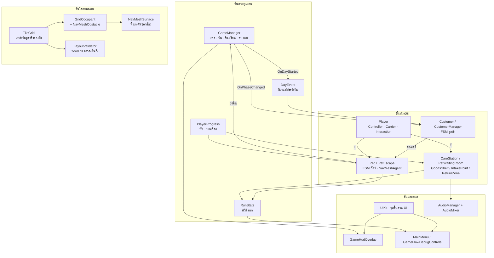
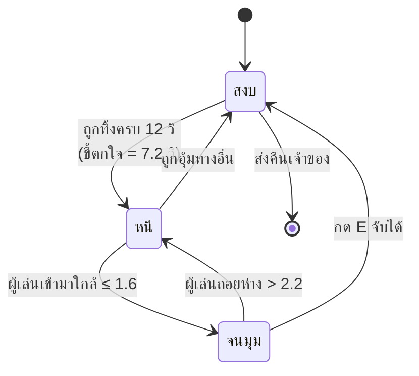
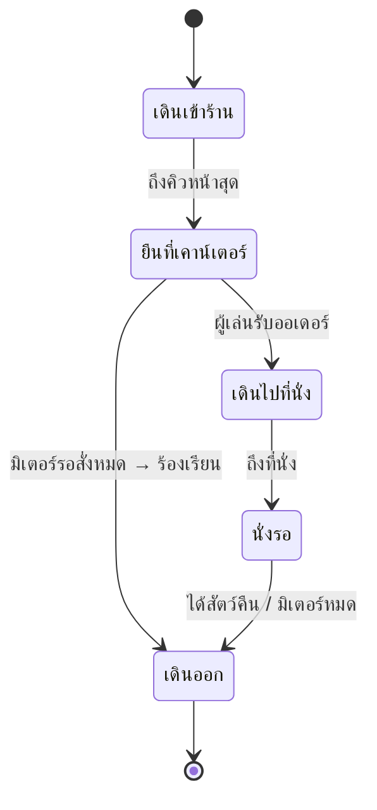
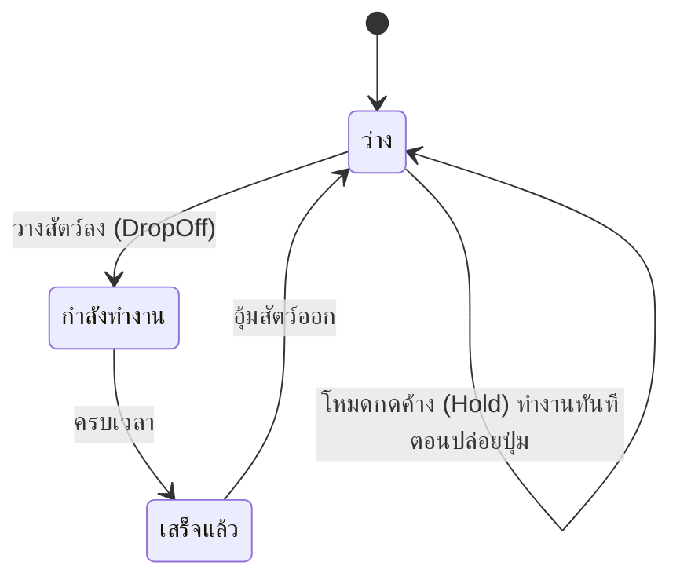

# Pet Corner — ชุดข้อมูลสำหรับ Final Presentation

**สำหรับนำเสนอ 3 พ.ย. 2569 · อัปเดต 2 พ.ย. 22:45**

---

## 1. ธีม — "What home means to you"

### แนวคิด
บ้านของผู้เล่น **ไม่ได้เป็นบ้านของผู้เล่นคนเดียวอีกต่อไป** — มันกลายเป็นบ้านหลังที่สองของสัตว์ที่เจ้าของฝากไว้
ผู้เล่นจึงต้องเลือกตลอดเวลาว่า *บ้านหลังนี้จะเป็นบ้านแบบไหนสำหรับพวกเขา*

### ธีมปรากฏในกลไกจริง 6 จุด

| จุดในเกม | เชื่อมกับธีมอย่างไร |
|---|---|
| **จัดผังบ้านเองทุกวัน** (ยก/วางสถานีด้วย E) | "บ้าน" ไม่ใช่ฉากตายตัว แต่เป็นสิ่งที่ผู้เล่นออกแบบว่าจะให้สัตว์อยู่ยังไง — บ้านที่จัดดี = สัตว์ได้รับการดูแลทัน |
| **ห้องรอรับสัตว์** ข้างเคาน์เตอร์ | จุดที่สัตว์ "เพิ่งมาถึงบ้านใหม่" และยังไม่มีใครดูแล — เป็นพื้นที่ปลอดภัย สัตว์ในห้องนี้จะไม่หนี |
| **สัตว์หนีเมื่อถูกทิ้งไว้นาน** | บ้านที่ไม่มีใครสนใจ = ไม่ใช่บ้าน สัตว์จึงออกไปหาทางเอง ผู้เล่นต้องวิ่งตามกลับมา |
| **checklist ความต้องการต่างกันรายตัว** (อาหาร/อาบน้ำ/เล่น/พัก) | "บ้าน" ของสัตว์แต่ละตัวไม่เหมือนกัน แมวต้องการที่พัก หมาต้องการที่เล่น |
| **บุคลิกสัตว์** (ขี้ตกใจ / ติดคน) | ตัวที่ขี้ตกใจหนีเร็วกว่า ตัวที่ติดคนสงบลงเมื่ออยู่ในมือผู้เล่น — บ้านที่ดีสำหรับตัวหนึ่งไม่ใช่บ้านที่ดีของอีกตัว |
| **ตู้สินค้า + ของที่เจ้าของขอ** | เจ้าของฝากสัตว์ไว้แล้วยังขอของกลับบ้านด้วย — บ้านหลังนี้ส่งสัตว์คืนพร้อมความทรงจำ ไม่ใช่แค่ส่งคืนตัว |

### ข้อความในเกม (อัปเดตแล้ววันนี้)
- หน้าเมนูหลัก: **"บ้านของคุณ · บ้านหลังที่สองของพวกเขา"**
- บรรทัดรอง: **"What home means to you — เปิดบ้านรับฝากสัตว์ให้รอดครบทุกวัน"**

### ประโยคปิดสำหรับสไลด์
> "เกมนี้ถามคำถามเดียวซ้ำทุกวันในเกม: วันนี้บ้านของคุณเป็นบ้านแบบไหนสำหรับสัตว์ที่ฝากไว้ — บ้านที่จัดมาดี หรือบ้านที่มันอยากหนีออกไป"

---

## 2.3 แผนภาพระบบ (System Overview)

### ภาพรวม 4 ชั้น

### หลักการออกแบบที่ใช้พูด 3 ข้อ

1. **TileGrid เป็นแหล่งข้อมูลจริงแหล่งเดียวของผังร้าน** — ทุกระบบ (วางของ / ตรวจผัง / NavMesh / วางสถานีอัตโนมัติ) อ่านจากที่เดียว ไม่มีใครเก็บตารางของตัวเองซ้ำ
2. **ระบบคุยกันผ่าน event ไม่ใช่เรียกตรง** — `GameManager` ยิง `OnPhaseChanged` / `OnDayStarted` แล้วใครสนใจค่อย subscribe เพิ่มระบบใหม่ได้โดยไม่แก้ `GameManager`
3. **คอมโพเนนท์เสริมติดตัวเองอัตโนมัติ** — `Pet` ใส่ `PetEscape` ให้เอง · `GridOccupant` ใส่ `NavMeshObstacle` ให้เอง · `CareStation` ใส่ `CareStationEffects` ให้เอง = เพิ่มระบบใหม่ไม่ต้องไล่แก้ prefab ทีละตัว

---

## 3.7 FSM ในเกม

### FSM 1 — สัตว์เลี้ยง (ใหม่วันนี้ · ScriptableObject + NavMesh)

| สถานะ | ไฟล์ asset | ทำอะไร |
|---|---|---|
| **สงบ** | `PetState_Calm.asset` | นับเวลาถูกทิ้ง · ไม่นับถ้าอยู่ในมือ/ห้องรอ/สถานีที่กำลังทำงาน |
| **หนี** | `PetState_Flee.asset` | เดินด้วย `NavMeshAgent` · ผู้เล่นใกล้ = หนีออกห่าง · ไกล = เดินเปะปะในรัศมี 7 |
| **จนมุม** | `PetState_Cornered.asset` | หยุด หันหน้าหาผู้เล่น รอกด E |

**ตัวรัน FSM:** `PetEscape.cs` ทำหน้าที่เป็น blackboard (ระยะถึงผู้เล่น, agent, ตัวนับเวลา) และสลับสถานะทุกเฟรม

### FSM 2 — ลูกค้า (มีอยู่เดิม)

### FSM 3 — สถานีดูแล (มีอยู่เดิม)

### FSM ที่ออกแบบไว้ต่อยอด (พูดเป็นแผนได้)

| FSM | สถานะ | ใช้ทำอะไร |
|---|---|---|
| **พนักงาน (NPC)** | รองาน → เดินไปรับสัตว์ → ใช้สถานี → ส่งคืน | ใช้โครง `PetState` เดิมได้ทันที เพราะ NavMesh พร้อมแล้ว |
| **เจ้าของมารับคืน** | นั่งรอ → ลุกมาที่เคาน์เตอร์ → รอรับ → เดินออก | เติมเฟสที่ 3 ของ Owner Patience ตาม GDD |
| **สัตว์ขี้เล่น** | สงบ → ซน (เดินเล่นเองในรัศมีแคบ) → หนี | ต่อยอดจากบุคลิกสัตว์ที่มีอยู่ |

---

## 3.2 การใช้ ScriptableObject

### ที่ใช้อยู่แล้ว

| Asset | เก็บอะไร | ใครอ่าน |
|---|---|---|
| **`PetSpecies`** (3 ไฟล์) | ชื่อ · prefab · checklist ขั้นตอน · ความอดทน · ค่าบริการ · บุคลิก | `IntakePoint` · `Pet` · `CustomerManager` · `DayEndShop` |
| **`PetState`** (3 ไฟล์ · ใหม่วันนี้) | พฤติกรรมแต่ละสถานะของ FSM + ค่าจูน (ความเร็วหนี · รัศมีจับ · เวลาถูกทิ้ง) | `PetEscape` |

### ประโยชน์ที่ได้จริง (ใช้พูด)
- **ปรับค่าโดยไม่คอมไพล์ใหม่** — เปลี่ยน "ความอดทน 75 วิ" หรือ "ความเร็วหนี 2.6" จากหน้า Inspector ได้ทันทีแม้ขณะกด Play
- **สัตว์คนละชนิดใช้พฤติกรรมคนละชุดได้** — แมวใช้ `PetState_Flee` ที่หนีไกลกว่า โดยไม่ต้องเขียนคลาสใหม่
- **ข้อมูลไม่ซ้ำในหน่วยความจำ** — สัตว์ 10 ตัวที่เป็นแมวใช้ `Species_Cat` ไฟล์เดียวกัน ไม่ได้ก๊อปค่าไปตัวละชุด

### ออกแบบไว้เพิ่ม (พูดเป็นแผนได้)

| Asset ที่จะทำ | เก็บอะไร | แทนที่อะไรในวันนี้ |
|---|---|---|
| **`DayEventAsset`** | อีเวนต์ประจำวัน (ชื่อ · ตัวคูณความอดทน · ตัวคูณค่าบริการ · ระยะห่างลูกค้า) | ตอนนี้เป็น `[Serializable] class` ในโค้ด — ย้ายเป็น asset แล้วเพิ่มอีเวนต์ใหม่ได้โดยไม่แตะโค้ด |
| **`GoodsItemAsset`** | สินค้าในตู้ (ชื่อ · ราคา · สี · ไอคอน) | ตอนนี้เป็นลิสต์ใน `GoodsShelf` |
| **`RewardCardAsset`** | การ์ดรางวัลท้ายวัน (บัฟ + ราคาที่ต้องจ่าย) | ตอนนี้สร้างในโค้ด `DayEndRewardSystem.BuildDefaultPool()` |
| **`ShopBlueprint`** | ผังร้าน (ขนาดกริด · กำแพง · ประตู · ช่องห้ามวาง) | ยังไม่มี — เป็นฐานของระบบออกแบบผัง |
| **`SoundSettings`** | ระดับเสียง Master/Music/SFX ที่ผู้เล่นตั้งไว้ | ตอนนี้เก็บเป็นตัวแปรใน `AudioManager` |

---

## 2.1 / 2.2 คอมโพเนนท์

### คอมโพเนนท์จากรายวิชาที่เอามาใช้

| คอมโพเนนท์ | ใช้ที่ไหนในเกม |
|---|---|
| **Input System** (Project-Wide Actions) | `GameInput` ตัวกลางเดียวของทั้งเกม รองรับคีย์บอร์ด + จอย |
| **NavMesh / NavMeshAgent / NavMeshObstacle** | สัตว์ที่หนีเดินอ้อมสถานีและกำแพง · สถานีทุกชิ้น carve พื้นที่เดินแบบ realtime |
| **Animator (Humanoid)** | `PlayerAnimator` (Idle/Walk + เลเยอร์ Carry + Avatar Mask) · `CustomerAnimator` |
| **CharacterController** | การเดินของผู้เล่น |
| **ProBuilder** | ห้องร้านทั้งห้อง (พื้น กำแพง เคาน์เตอร์) |
| **Audio Mixer + Groups** | แยก Music / SFX · เสียงสถานีวิ่งผ่าน SFX group |
| **Canvas / uGUI** | HUD และหน้าจอทั้งหมด สร้างด้วยโค้ดผ่าน `UiKit` |
| **ScriptableObject** | `PetSpecies` · `PetState` |
| **Physics (Rigidbody/Collider/Raycast)** | การอุ้มของ · การเล็งโต้ตอบ · การชน |
| **URP** | วัสดุและแสงทั้งฉาก |

### คอมโพเนนท์ที่เขียนขึ้นเอง (42 สคริปต์)

| กลุ่ม | สคริปต์ |
|---|---|
| แกนเกม | `GameManager` `PlayerProgress` `RunStats` `DayEvent` `GameLog` |
| ผังร้าน | `TileGrid` `GridOccupant` `TilePlacer` `PlacementPreview` `LayoutValidator` `LevelInitializer` `StationCatalog` |
| ตัวละคร | `PlayerController` `PlayerCarrier` `InteractionManager` `CameraController` `CharacterAnimationDriver` |
| ลูกค้า/สัตว์ | `Customer` `CustomerManager` `Pet` `PetSpecies` **`PetEscape` + `PetState` ×4** |
| สถานี | `CareStation` `CareStationEffects` `PetWaitingRoom` `GoodsShelf` `IntakePoint` `ReturnZone` `EquipmentParcel` |
| เศรษฐกิจ | `DayEndRewardSystem` `DayEndShop` `MoneyUIDisplay` |
| แสดงผล | `UiKit` `GameHudOverlay` `MainMenu` `GameFlowDebugControls` `StationCloseupOverlay` `CareStepStyle` |
| ระบบ | `GameInput` `AudioManager` |

---

## สิ่งที่เปลี่ยนวันนี้ (2 พ.ย.)

1. **FSM ของสัตว์เป็น ScriptableObject จริง** — 3 สถานะแยกไฟล์ `Assets/PetStates/`
2. **NavMesh ใช้งานจริง** — อบจากห้อง (32 สามเหลี่ยม) · agent รัศมี 0.25 สูง 0.8 เหมาะกับตัวสัตว์
3. **สัตว์ไม่ทะลุสถานีอีกแล้ว** — `GridOccupant` ใส่ `NavMeshObstacle` แบบ carve ให้ของทุกชิ้นบนกริดอัตโนมัติ
4. **สัตว์ติดพื้นเสมอ** — ตอนเริ่มหนีใช้ `NavMesh.SamplePosition` + `agent.Warp` วางตัวลงบนพื้นก่อนเดิน
5. **ธีมปรากฏในเมนู** — ข้อความหน้าแรกเปลี่ยนเป็นประโยคธีม

## ต้องทำก่อนส่ง (เหลือ)

- [ ] เปิด Unity กด Play เทสว่าสัตว์หนีแล้วอ้อมสถานีจริง (ต้องให้หน้าต่าง Unity อยู่หน้าสุด)
- [ ] commit + push
- [ ] build ใหม่ (ของเดิมเป็นของ 16 ก.ย.)
